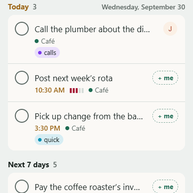

# Pocket for Vikunja

**Your team's tasks and checklists, on their phones, in the Vikunja you already host.**

<p align="center"></p>

Pocket is a phone app that runs inside Vikunja as a plugin. Your team opens a link, signs in with their Vikunja account, and adds it to the home screen. No app store, no account with anyone else, nothing to pay per person.

> **Everything Pocket makes is ordinary Vikunja data: projects, tasks, comments, attachments, labels and reactions.** Remove the plugin and it's all still there. [What Pocket stores.](docs/data.md)

## Why

"Is anyone doing this yet?" gets asked all day in a small shop. The paper checklist gets filled in twice, or three times, and nobody can say when. Small jobs leave no trace. At the end of the day, you can't say what you did. Vikunja already holds the tasks, but its web app is built for a desk. Pocket is the phone side of the Vikunja you already run.

## Who it's for

**Managers who work the floor.** You run the place and do the small jobs too.

**The crew who tick the checklists.** Today's checklist is waiting when they open Pocket.

**Anyone with work they repeat.** Write the steps once and stop carrying them in your head.

Pocket is the wrong fit for planning on a board, assigning every task from the top, or tracking time.

## What it does

### Record the work as you do it

Swipe right to show progress. Tap the circle when a task is done. Start a new task with `x ` to log a job you already did. Quick add shows what it read before you send it. **Done today** lists everything you finished, ready to paste into a message. [Quick add](docs/guide.md#quick-add) · [Tasks](docs/guide.md#tasks)

### See who's on it



Tap **+ me** and it's yours. Showing progress on a task no one had makes it yours too. Hold **+ me** to hand it off. Nobody has to ask who's on it. [Assigning](docs/guide.md#assigning)

### Checklists that get finished


A manager writes the steps once. The crew ticks them one at a time, and each tick records who and when. A step can wait, or ask for a reading such as a temperature. An odd reading is saved in amber, not refused. Step order and times are enforced only if you turn them on. [Checklists](docs/guide.md#checklists)

### Everything due, on one screen

Today shows what's due this week. A due checklist shows for the people it's assigned to, or for everyone who can start it when it's assigned to no one. Plan in Vikunja's web app. Do the work from Today.

## Install

Requires Vikunja 2.7 or later.

1. Download the [latest release](https://github.com/ssweber/pocket-for-vikunja/releases/latest) and unzip it into Vikunja's `plugins` folder, so you have `plugins/pocket/main.go` and `plugins/pocket/app/index.html`.

2. In `config.yml`:

   ```yaml
   plugins:
     enabled: true
     loader: yaegi
     pocket:
       steptimes: true        # optional: timed steps get due dates, so they show on Today and in email reminders
   service:
     maxitemsperpage: 500     # optional: long lists load in fewer requests
   ```

   If you already have a `service:` section, add the line there. As environment variables: `VIKUNJA_PLUGINS_POCKET_STEPTIMES=true` and `VIKUNJA_SERVICE_MAXITEMSPERPAGE=500`. More on [step times](docs/guide.md#step-times).

3. Restart Vikunja. The log should include `pocket: serving … at /api/v1/plugins/pocket/`.

4. Open `https://<your Vikunja>/api/v1/plugins/pocket/` on your phone, sign in, and add it to your home screen.

To update, unzip the new release over `plugins/pocket/`. Every phone picks it up the next time Pocket opens. Restart Vikunja only if `main.go` or `relay.go` changed.

Cloudron: the plugins folder is `/app/data/plugins/` and `config.yml` is `/app/data/config.yml`.

## Good to know

- **Unofficial.** Report problems here, not to Vikunja.
- **0.x.** Expect changes between releases. The [changelog](CHANGELOG.md) says what.
- **Works offline.** Pocket opens without a connection and sends what you did once it has one. Ticks, deletes and moves can be undone.
- **No push notifications.** Timers sound while Pocket is open. Otherwise reminders come by Vikunja's email, which needs `mailer` configured.
- **Vikunja checks every change.** The plugin passes Pocket's changes to Vikunja's API as the signed-in user. With step times on, it also sets due dates on checklist steps itself. It makes no outside requests. [Privacy and security](docs/guide.md#privacy-and-security)

## More

The [guide](docs/guide.md) has the quick-add syntax, gestures, templates, asks and troubleshooting. To work on Pocket itself, see [docs/development.md](docs/development.md).

MIT licensed.
