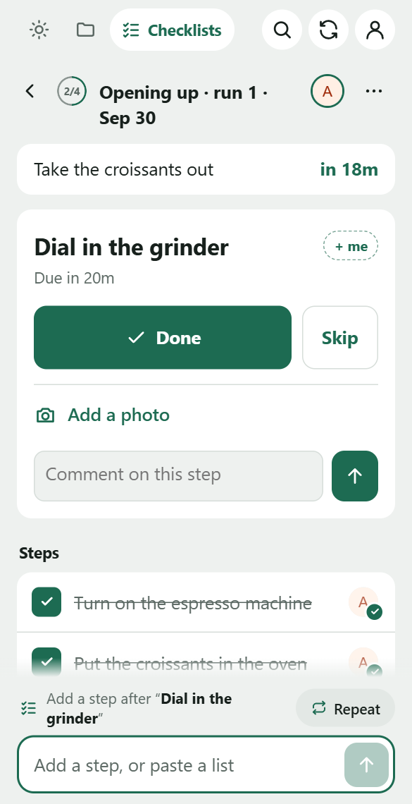
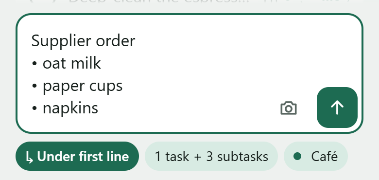
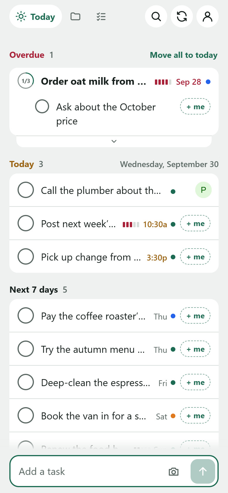

# Pocket for Vikunja

**Tasks and checklists for [Vikunja](https://vikunja.io), on the go.**

Turn the things you do again and again, like opening up and closing down, into checklists that you and your team tick
off, step by step. Add a task in a line, say it's yours and how far along with a swipe, or hand it to a teammate with
an @.

<table>
  <tr>
    <th>Checklists</th>
    <th>Tasks</th>
  </tr>
  <tr>
    <td></td>
    <td></td>
  </tr>
</table>

Pocket is a home-screen app served by your own Vikunja, through a plugin. It needs no app store, no new account and
no server of its own, and you can read every line before you install it. It has the same account and the same tasks
as Vikunja's web app, [on a screen made for a phone](docs/guide.md#pocket-and-vikunjas-web-app).

<sub>Pocket is an unofficial companion, not made by the Vikunja team. Please report problems with it here, not to
Vikunja.</sub>

## Repeatable checklists

Write the steps once, as a template: "Turn on the espresso machine", "Put the croissants in the oven", "Take the
croissants out in 18 min". Then start a run each morning, for yourself or whoever's on shift, and work through it one
step at a time, with a comment or a photo where it helps. Timed steps count down, and each tick records who did it. A
template can come round by itself, every day at 8:00, say, and wait on Today to be started. It's all ordinary Vikunja
tasks, so Vikunja's web app shows it too.



## Add it in a line

Type a task the way you'd say it: "Order 6 bags of house blend fri at 9 +orders !3". Pocket highlights the words it
read and shows them as chips before you send. The shortcuts are Vikunja's own, `+project`, `*label`, `@person` and
`!priority`, with dates in plain words.

Start a line with `x` for something you've done already: "x Called the plumber" goes in ticked. Now you can answer
"what have I done today?"

Paste a list from your notes or a message: each line is a task, the lines indented or under a heading are its
subtasks, and the ones ticked with `[x]` are done.



## Say it's yours, and how far along

Every row ends with who's doing it, or **+ me**. Swipe a task to the right to say how far along it is, a quarter at a
time, or all the way to finish it. If no one had it, it's now yours: one swipe tells the team who's on it and how far
they've got. A task with subtasks is a card on Today that shows the one to do next, and its ring adds up their
progress.

Add `@priya` and the task is Priya's, in a project Priya can see. For someone who isn't in Vikunja, **Share progress
as a text** sends a few plain lines through the phone's share sheet: "Pack the van ▰▱▱▱ 38%".



## The rest

**Today** has what's overdue, what's due today and the week ahead, and whatever you tick, delete or move there can be
taken back. Pocket opens without a connection, and keeps what you write until it's sent. Timers ring while Pocket is
open; reminders arrive by email when it's closed, so the server needs mail set up (see
[reminders](docs/guide.md#reminders-and-alerts)).

## Install

Pocket needs Vikunja 2.7 or later.

1. **Download `pocket-v….zip`** from the [latest release](https://github.com/ssweber/pocket-for-vikunja/releases/latest)
   and unzip it into Vikunja's `plugins` folder, so that you have `plugins/pocket/main.go` and
   `plugins/pocket/app/index.html`. On Cloudron, use the Vikunja app's **File Manager** to put it at
   `/app/data/plugins/pocket/`; elsewhere, `plugins` goes in Vikunja's root path.

2. **Add this to Vikunja's `config.yml`** (`/app/data/config.yml` on Cloudron):

   ```yaml
   plugins:
     enabled: true
     loader: yaegi
     pocket:
       steptimes: true   # timed checklist steps get due dates in Vikunja; leave this line out to keep the plugin read-only
   ```

   With step times on, the plugin sets the due dates of checklist steps, and changes nothing else: see [Step
   times](docs/guide.md#step-times). Read [`pocket/main.go`](pocket/main.go) first if you like; it's about 600 lines.

   And this, so that Pocket loads a long list in fewer requests:

   ```yaml
   service:
     maxitemsperpage: 500   # in the service: section you have, if there is one; Vikunja's web app is unaffected
   ```

   Vikunja set up with environment variables instead (in Docker, say) takes `VIKUNJA_SERVICE_MAXITEMSPERPAGE=500`.
   Restart Vikunja: its log should now include `pocket: serving … at /api/v1/plugins/pocket/`.

3. **Open Pocket on your phone** at `https://<your Vikunja>/api/v1/plugins/pocket/` and sign in the way you sign in to
   Vikunja. You're then signed in to both on that phone.

4. **Add it to your home screen** from the browser's Share or menu button.

**Updating:** unzip a newer release over `plugins/pocket/`, then open Pocket while online: the new version shows the
next time it opens. Vikunja needs a restart only for a changed `main.go`.

## Your first checklist

1. Under Projects, tap **Set up checklists**: a project called Checklists, with an example to try. Share it in
   Vikunja's web app with whoever will run them, as **Read & write**, so they can tick steps.
2. Under Checklists, tap **New template** and write its steps, a row each. `@priya` in a step gives it to Priya, and
   "in 18 min" times it.
3. Tap **Start** and choose who the run is for.
4. Work through it: **Done**, or **Skip**.

The [guide](docs/guide.md) has each screen in full, with [every quick add shortcut](docs/guide.md#quick-add),
[offline](docs/guide.md#offline), [troubleshooting](docs/guide.md#troubleshooting) and [privacy and
security](docs/guide.md#privacy-and-security).

## Development

The app is written in `src/` with Alpine.js, and `npm run build` makes it into the one file the plugin serves,
`pocket/app/index.html`. `npm run dev` starts a local Vikunja with the plugin loaded, and rebuilds as you edit. See
[docs/development.md](docs/development.md) for the layout, the tests and the bundled libraries.

## License

MIT. See [LICENSE](LICENSE). Alpine.js and chrono-node are also MIT licensed.
