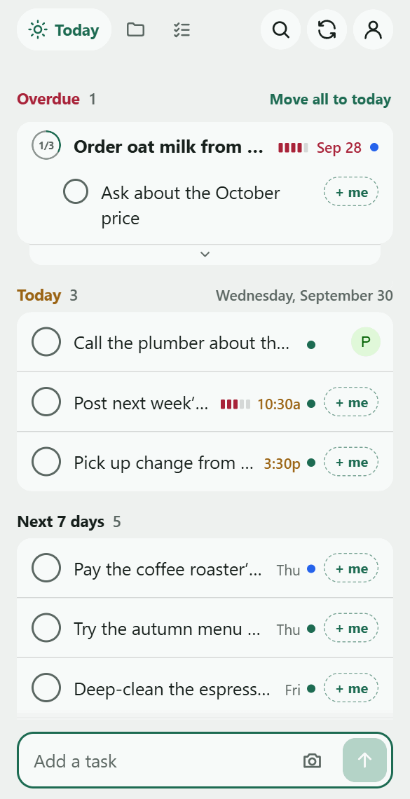

# Pocket for Vikunja

Pocket is a mobile interface for Vikunja, installed as a plugin. It uses your existing Vikunja account and data, and adds three things the web app doesn't do well on a phone: repeatable checklists, fast task entry, and progress tracking.

<table>
  <tr>
    <th>Checklists</th>
    <th>Tasks</th>
  </tr>
  <tr>
    <td></td>
    <td></td>
  </tr>
</table>

Pocket is unofficial. Report problems here, not to Vikunja.

## What it adds

**Checklists.** Pocket creates step-by-step checklists from a task template. Each checklist records who completed each step and when. Steps can have timers relative to the previous step, and templates can recur on a schedule. A step can ask for answers, such as a temperature or a yes or no, and each answer is saved as a comment that an export can read. Checklists are ordinary Vikunja tasks and appear in the web app.

**Quick add.** Type a task using Vikunja's quick-add syntax: `+project`, `@user`, `*label`, `!priority`, and natural-language dates. Pocket shows what it parsed before you submit. Paste a list and each line becomes a task. Indented lines become subtasks.

**Progress.** Swipe a task to set its progress in 25% increments. Setting progress on an unassigned task assigns it to you. Parent tasks show the aggregate progress of their subtasks. Progress can be shared as plain text through the phone's share sheet.

**Offline.** Pocket opens without a connection and queues new tasks, comments, and checklist activity until it reconnects.

## How it works

The plugin serves a single-page web app from `/api/v1/plugins/pocket/`. It runs inside Vikunja, has no server of its own, and makes no outside requests. Sign-in is Vikunja's own.

The plugin is about 600 lines of Go in [`pocket/main.go`](pocket/main.go). By default it only serves files. With `steptimes: true` it also writes due dates to timed checklist steps, so reminders and the web app's views reflect them.

## Install

Requires Vikunja 2.7 or later.

1. Download the [latest release](https://github.com/ssweber/pocket-for-vikunja/releases/latest) and unzip it into Vikunja's `plugins` folder: `plugins/pocket/main.go`, `plugins/pocket/app/index.html`.

2. In `config.yml`:

   ```yaml
   plugins:
     enabled: true
     loader: yaegi
     pocket:
       steptimes: true   # optional; see docs/guide.md#step-times
   service:
     maxitemsperpage: 500   # in the service: section you have, if there is one; long lists load in fewer requests
   ```

   With environment variables instead: `VIKUNJA_SERVICE_MAXITEMSPERPAGE=500` and `VIKUNJA_PLUGINS_POCKET_STEPTIMES=true`.

3. Restart Vikunja. The log should include `pocket: serving … at /api/v1/plugins/pocket/`.

4. Open `https://<your Vikunja>/api/v1/plugins/pocket/` on your phone, sign in, and add it to your home screen. After single sign-on from the home screen, Vikunja's page stays open. Close it to return to Pocket.

To update, unzip the new release over `plugins/pocket/`. Vikunja needs a restart only if `main.go` changed.

Cloudron: the plugins folder is `/app/data/plugins/`, and `config.yml` is `/app/data/config.yml`.

## Reminders

Timers sound while Pocket is open. When it's closed, reminders arrive by Vikunja's email, which needs `mailer` configured on the server. Pocket sends no push notifications.

## Documentation

The [guide](docs/guide.md) covers the full quick-add syntax, behavior you might not expect, checklist templates, asks, step times, offline behavior, API tokens, and troubleshooting.

## Development

The app is Alpine.js in `src/`. `npm run build` produces `pocket/app/index.html`. `npm run dev` starts a local Vikunja with the plugin loaded. See [docs/development.md](docs/development.md).

## License

MIT.
