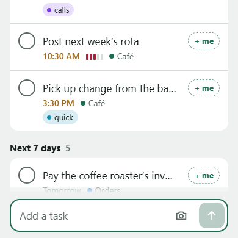
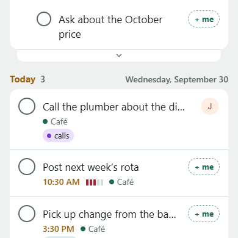
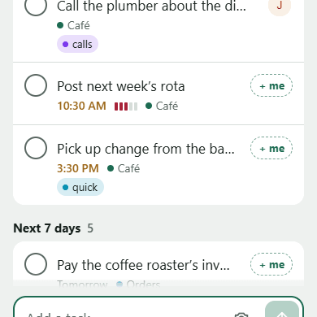
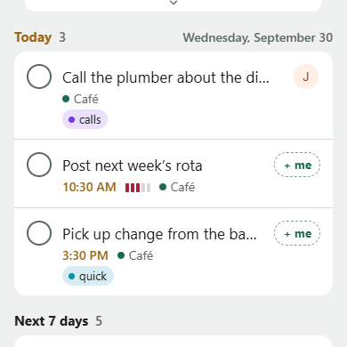
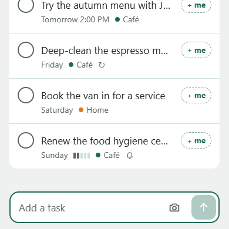
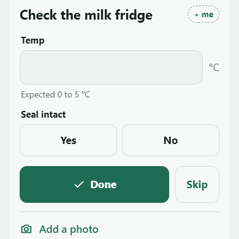

# Pocket guide

What the [README](../README.md) leaves out: the quick-add syntax, the gestures, how checklists work, and the server setup.

**Using Pocket:** [Quick add](#quick-add) · [Tasks](#tasks) · [Assigning](#assigning) · [Checklists](#checklists) · [Timed steps](#timed-steps) · [Asks](#asks) · [Reminders](#reminders) · [Offline](#offline)

**On the server:** [Step times](#step-times) · [Troubleshooting](#troubleshooting) · [Privacy and security](#privacy-and-security) · [What Pocket stores in Vikunja](data.md)

## Quick add

Pocket reads Vikunja's [Quick Add Magic](https://vikunja.io/help/quick-add-magic/), in the mode set in your Vikunja settings. Chips under the box show what will be saved. Tap a chip to keep its words in the title.



| Type | Sets |
|---|---|
| `+orders`, `+"Café"` | Project. The start of a name is enough when only one project has it. |
| `*suppliers` | Label. A new label is created. |
| `@user` | Assignee |
| `!1` to `!5` | Priority |
| `fri`, `next monday`, `in 3 days`, `Oct 12`, `10/12` | Due date. `10/12` follows your phone's locale. |
| `at 5`, `at 17:30`, `tomorrow morning` | Due time. A bare hour from 1 to 7 is PM. Morning is 9 AM, afternoon 3 PM, evening 6 PM and night 8 PM. |
| `every day`, `every other week`, `every month` | Repeat. `every month` keeps the same day of the month. |
| `50%` at the end | Progress |
| `x ` at the start | Done already |
| `Order bags // the brown ones` | Notes, from the text after ` // ` |

Wrap the whole text in quotes to turn parsing off: `"Friday night jazz poster"`.

<details>
<summary><b>Every rule</b>, and where Pocket differs from Vikunja's parser</summary>

- Typing `+` suggests projects, and typing `*` suggests labels.
- Numeric dates such as `10/12` are read only at the start or end of the text, so "Table 4/5 wobbles" is left alone. Vikunja always reads `10/12` as a US date.
- Without a time, a task gets your default due time from Vikunja's settings.
- `at 5` is 5 PM. Vikunja reads it as 5 AM. After a morning, a bare hour is read as written: `tomorrow morning at 6` is 6 AM. After an evening or a night, a bare hour up to 11 is PM.
- `this morning` and `tonight` are today, even once that time has passed. Vikunja reads `tonight` as 9 PM. `morning` on its own stays in the title.
- After a night, `at 12` and `at midnight` are the midnight that ends the day, and `at 1` to `at 4` are the small hours after it. `tonight at 1` is 1 AM tomorrow.
- After a repeat, a part of the day sets the time it repeats at: `every monday evening` is Mondays at 6 PM.
- Vikunja can't repeat on weekdays only, so `every weekday` stays in the title and a chip says so. `every month` repeats on the same day each month, where Vikunja uses every 30 days.
- A date means its next occurrence. In June, `2nd March` is next March.
- Pocket also reads `every monday`, `every other day` and `the 17th` anywhere in the text.
- A `@user`, `*label` or `+project` in the middle of the text keeps its word in the title, without its sign: `Fix the *urgent leak` is "Fix the urgent leak", with the label urgent. At the start or the end, the word is removed, as in Vikunja. Other `@`, `*` and `+` words, dates, repeats, priorities and percentages between it and that end don't count: `Call the plumber @user *home tomorrow` is "Call the plumber".
- A `@user` who can't be assigned stays as typed. Without a `+project`, if exactly one of your projects is shared with them, Pocket picks it and shows a chip.
- `(50%)` works as well as `50%`, and `100%` is done. `[x] ` and `X ` work as well as `x `.
- Notes start after the first ` // `. Slashes without a space on both sides, as in `http://`, stay in the title. An indented line under the text that starts with `//` adds a line to the notes.
- Quotes at the start keep the title as typed and parse the rest: `"Lunch friday" @user tomorrow`.

</details>

**Pasting a list.** Each line becomes a task, in the first `+project` found. Indented lines, lines under a `## ` heading, and lines after a first line ending in a colon become subtasks. The pictures under the box offer other ways to add the lines, such as one task with the rest as its notes.


**Shortcut link.** `…/#/add?text=Order+milk` opens Pocket with the text filled in, for an iOS Shortcut or a bookmark.

## Tasks

| Gesture | What it does |
|---|---|
| Tap the tick | Marks the task done. A task with open subtasks has a ring instead. |
| Swipe right | Raises progress a quarter at a time. All the way marks it done. |
| Swipe left | Lowers progress. At 0%, deletes the task. |
| Hold, on a project | Lifts the row so you can drag it up or down. |
| Hold, on Today | Shows four date chips to move the task to. |
| Nudge | Moves the add box under the row, to add a subtask there. |
| Hold **+ me** | Opens the people you can assign. |

Every gesture is also in the task's **⋯** menu. Right-click a row, or press Shift+F10, to open it.

**Moving a task to another day.** On Today, hold a task until it lifts. Today is left, Tomorrow right, Next week up and No date down. Let go without moving to tap one, or **Pick a date…**.



**Adding under a row.** A nudge is a press and a slight scroll, or a short, slow drag with a mouse. The add box moves under the row and adds a subtask there. **⇤** and **⇥** (Shift+Tab and Tab) move it out and in a level. Tap the dashed outline to send it back.



**Good to know.**

- Setting progress on an unassigned task in a shared project assigns it to you.<br>
- Ticking every subtask doesn't close the parent. Tap the parent's ring to close it.
- A parent's progress is the average of its subtasks'.
- Ticked and deleted tasks stay for three seconds, with **Restore**, before they leave.
- A task with a date and no time becomes overdue when that day ends.
- **Move to another project**, in a task's **⋯**, takes its subtasks with it.
- Today shows what is due this week. Tap a label there to show only its tasks. Search for `*label` to find every open task with it.
- **Copy**, beside **⋯**, copies a list's progress as text. **Copy as a Markdown list** makes text that pastes back into the add box as the same tasks.
- Alt+Up and Alt+Down move the add box through the rows.

**Done today**, at the bottom of Today, lists what you finished today. **Copy** copies it as text. Vikunja doesn't record who ticks a task, so Pocket adds your ✅ to each one you tick. A task ticked in Vikunja's web app is listed only if it's assigned to you or in a project only you can see.




## Assigning

- Hold **+ me**, or your picture, to assign someone else.<br>
- **+ me** shows only in shared projects.
- Only people who can see the project can be assigned. Typing `@` suggests them.
- Assigning never marks anything done. Whoever ticks the task is recorded.
- A checklist's row shows who it's for. Change it in the checklist's **⋯**. Vikunja notifies them once, not for each step.
- To reassign one step, open the checklist's **⋯**, tap **Open as a task**, then tap the step.

## Checklists

A template is a procedure your team repeats. Starting it creates a checklist, which records who did each step and when.

<p align="center"></p>

**Setting up.** Tap **Set up checklists** on the Checklists tab, or **Use for checklists** in a project's **⋯**. Share the project in Vikunja's web app with **Read & write**. With *Read only*, people see checklists but can't tick steps.

**Templates.**

- Steps read like quick add, except for dates. Tap to edit. Hold to reorder. Swipe left to delete.
- A step's notes, photos and asks are copied into every checklist.
- **Use as checklist template** turns a task with subtasks into a template.
- In Pocket, only the template's creator or a project admin can change it. Everyone with **Read & write** can start checklists from it.
- Give a template a due date and a repeat interval to make it repeat. Today lists it from a week before. Starting it on or after the due day moves the template to its next date. Missed dates aren't made up.

**During a checklist.**

- A comment typed on a step is posted with **Done**, or saved as the reason with **Skip**.
- **Last time** shows the comments from the previous checklist.
- The box under the steps adds a step to this checklist only. **↻** repeats the step above it.
- Template steps can be skipped, not removed.
- Tap the checklist's ring to finish early.

**In Vikunja's web app.** A template is a task labeled `template`, and a checklist is a copy of it. A ✅ reaction on a step says who did it. Lines starting with `pocket:` are Pocket's records, so leave them in place. [What Pocket stores in Vikunja](data.md) has the details.

## Timed steps

Write the delay in the step: "Dial in the grinder **in 20 min**". It counts from the step before. To count from another step, pick it in the chip, or write "**20 minutes after** Turn on the espresso machine".

In Vikunja's web app, the timer is part of the step's title:

| Step title | Due |
| --- | --- |
| `Wipe the counters T#20m` | 20 minutes after the step before. For the first step, after the checklist starts. |
| `Put the croissants in the oven {#croissants}` | No timer. `{#croissants}` names the step. |
| `Take the croissants out T#18m:croissants` | 18 minutes after the step named "croissants". |

Units are `d`, `h`, `m`, `s` and `ms`, and they combine: `T#1h30m`. [Timers](data.md#timers) has the rest of the rules.

**Enforcing.** Two switches under a template's steps are off at first. **Enforce step times** stops a timed step being ticked early. **Enforce step order** stops a step being ticked while one above it is open. **Skip** still works. Vikunja's web app ignores both.

## Asks

A step can ask for a number, a yes or no, a choice, or a line of text. To add one, open the template, tap the step, then tap **Notes, photos and asks ›**.

On the checklist, **Save** sends the answers without ticking the step. **Done** sends them and ticks it. The newest answer counts. Asks don't block **Done**. A number outside its range is saved and shown in amber.




**For exports.** Each set of answers is a comment that ends with `pocket:answer`:

```
Temp: 7.5 °C
Seal intact: Yes
pocket:answer
```

An ask is a line in the step's notes, and it can be typed there:

| Line | Records |
| --- | --- |
| `pocket:ask Notes: text` | A line of text |
| `pocket:ask Temp: number °C 0..5` | A number. The unit and the range are optional. |
| `pocket:ask Seal intact: yes-no` | Yes or No |
| `pocket:ask Belt: choice Good \| Worn \| Replace` | One of the options |

[Asks](data.md#asks) and [Answers](data.md#answers) have the full format, for an export or an n8n flow.

## Reminders

- A countdown chimes while Pocket is open, and the screen stays awake. An iPhone with the silent switch on may not sound.
- When Pocket is closed, Vikunja sends reminders by email. That needs `mailer` and `service.enableemailreminders` in Vikunja's config, and email reminders turned on in your Vikunja settings.
- Typing a time in quick add offers a 🔔 reminder chip.
- With [step times](#step-times), timed steps get a reminder at their due time.
- The app icon shows how many tasks are overdue.

Pocket sends no push notifications. Vikunja's web push, in progress in [go-vikunja/vikunja#4020](https://github.com/go-vikunja/vikunja/pull/4020), would allow them.

## Offline

Pocket opens offline and shows lists as last loaded. Changes wait in the Outbox. The refresh button turns amber with a count. Tap it to see them. Closing the app loses nothing. If Vikunja refuses a change, its text returns to the box. An iPhone sends only while Pocket is open.

## Step times

With `steptimes: true` in `config.yml` (or `VIKUNJA_PLUGINS_POCKET_STEPTIMES=true`), ticking a step sets due dates on the steps timed from it. They then show on Today, in the web app and in email reminders. Without it, Pocket still counts down on the checklist. The plugin writes only those due dates and reminders, in `writeStepDueDates` in [`pocket/main.go`](../pocket/main.go).

- The web app and CalDAV clients overwrite the due date when they save a step they loaded before it was set.
- CalDAV clients and saved filters may not see the date until the step changes again, because the plugin leaves the modified time alone.
- A step ticked offline is timed, in Vikunja, from when the tick arrives.
- A tick the plugin handles more than 2 minutes late, or during a restart, sets no due dates.

## Troubleshooting

- **Pocket's URL returns "not found".** Check Vikunja's log for `pocket` or `plugin`.
  - `couldn't find app/index.html`: the files aren't at `plugins/pocket/app/`.
  - `Failed to load yaegi plugin pocket`: the plugin didn't load, possibly because a Vikunja update changed the plugin API. Vikunja keeps running.
  - Nothing: plugins aren't enabled, or Vikunja hasn't been restarted.
- **The log shows the old version after updating.** Vikunja reads `main.go` at startup. Restart it.
- **The log shows `… is not available to API tokens`.** Vikunja 2.7.1 and later log this at every start. Pocket doesn't use API tokens, so it is unaffected.
- **Vikunja's page stays open after single sign-on.** Signing in from the home-screen app ends on Vikunja's page. Close it to return to Pocket.
- **"Too many attempts from here".** 10 sign-in attempts per minute per address. Wait.
- **"@user can't see Inbox".** Share the project with them, or add a `+project` they can access.

## Privacy and security

- Pocket talks only to the Vikunja that serves it, with Vikunja's own session.
- For offline use, Pocket keeps the last-loaded lists, the Outbox and unsent text in the browser. Signing out clears them, and another account on the same phone never sees them.
- Notes and comments are sanitized before display. Attachments other than images, PDFs and plain text download instead of opening. This stops a collaborator's content from running code in Pocket, which shares Vikunja's origin.
- The plugin serves `app/` and passes Pocket's changes to Vikunja's API as the signed-in user, so Vikunja checks permissions as usual. It keeps Vikunja's answer to each change for 31 days in its own table, `pocket_relay`, so a change sent twice is made once. With step times on, it also sets due dates on checklist steps. Nothing else. [What the plugin writes](data.md#what-the-plugin-writes) has the details. Review [`pocket/main.go`](../pocket/main.go) and [`pocket/relay.go`](../pocket/relay.go) before installing.
