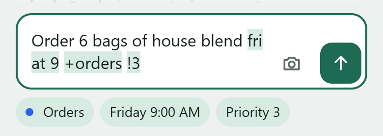
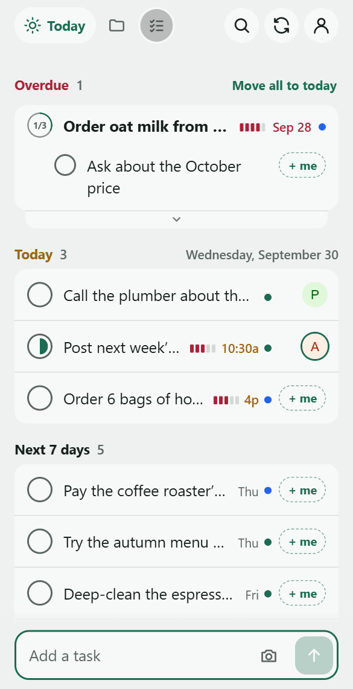

# Pocket guide

Pocket's syntax, the behaviour you might not expect, and the server setup. The [README](../README.md) says what Pocket is and how to install it.

- [Quick add](#quick-add)
- [Tasks](#tasks)
- [Assigning](#assigning)
- [Checklists](#checklists)
- [Timed steps](#timed-steps)
- [Asks](#asks)
- [Step times](#step-times)
- [Reminders](#reminders)
- [Offline](#offline)
- [Troubleshooting](#troubleshooting)
- [Privacy and security](#privacy-and-security)

## Quick add

Pocket uses the syntax of Vikunja's [Quick Add Magic](https://vikunja.io/help/quick-add-magic/) and follows your Vikunja setting for it: Vikunja mode (below), Todoist mode (`#project`, `@label`, `+person`), or off. Parsed words are highlighted as you type, and chips show what will be saved.



| Syntax | Sets |
|---|---|
| `+orders` or `+"Café"` | Project, by full name, or by the start of a name only one project has. Typing `+` suggests projects. |
| `*suppliers` or `*"call back"` | Label, created if it doesn't exist. Its chip then says **new label**. |
| `@user` | Assignee, by username |
| `!1` to `!5` | Priority |
| `today`, `tomorrow`, `fri`, `next monday`, `in 3 days`, `end of month`, `Oct 12`, `2026-10-12`, `10/12` | Due date. Numeric dates are read only at the start or end of the text, so "Table 4/5 wobbles" is left alone. |
| `at 5`, `at 5pm`, `at 17:30` | Due time. A bare hour from 1 to 7 means afternoon or evening. Without a time, the task uses your default due time from Vikunja's settings. |
| `every day`, `every other week`, `every month`, `weekly` | Repeat. Vikunja can't repeat on weekdays only or on specific days, so `every weekday` stays in the title and a chip says so. |
| `(50%)` or `50%` at the end | Progress. `100%` is done. Pocket only. |
| `x ` or `[x] ` at the start | Done already. Pocket only. A capital `X` works too. |

**Undoing a parse.** Tap a chip to keep those words in the title. Wrap the whole text in quotes to turn parsing off: `"Friday night jazz poster"`. Quotes at the start hold the title and leave the rest to parse: `"Lunch friday" @user tomorrow`.

**Pasting a list.** Each line becomes a task. The whole list goes to one project, the first `+project` found. Lines under a `## ` heading, lines indented more than the previous line, and lines after a first line ending in a colon (`Groceries:`) become subtasks. The **↳ Under first line** chip makes everything a subtask of the first line. Ticked lines arrive done. Tap the chip to leave them out instead.

**Differences from Vikunja's parser.** The same text usually makes the same task in both. Pocket differs on purpose here:

- `at 5` is 5 PM. Vikunja reads it as 5 AM.
- `every month` repeats on the same day each month. Vikunja uses every 30 days.
- A date means its next occurrence. In June, `2nd March` is next March.
- `10/12` follows your phone's locale. Vikunja always reads it as US format.
- Pocket also reads `every monday`, `every other day`, and `the 17th` anywhere in the text.

**Shortcut link.** `…/#/add?text=Order+milk` opens Pocket with the text filled in, for an iOS Shortcut or a bookmark.

## Tasks

Behaviour you might not expect:

- **Overdue** means the due time has passed, not the end of the day. A task due at midnight, which is how Vikunja's web app stores a date without a time, is overdue once that day ends.
- **Setting progress on an unassigned task assigns it to you** in a shared project. Lowering it back to 0% keeps the assignment. Tap your avatar to remove it.
- **Completing every subtask doesn't close the parent.** The card shows **Close** and waits. To close a parent with open subtasks, tap its ring or swipe the header fully right. With more than one open, Pocket asks first.
- **A parent's progress is the average of its subtasks'**, and Pocket writes that figure to Vikunja.
- **A task with progress takes two swipes to delete.** The first swipe lowers it to 0%.
- **Ticked and deleted tasks stay in place for three seconds**, then leave together. Until then, un-ticking and **Restore** work. A tick reaches Vikunja at once. A delete is sent only when the row leaves.
- **Moving a task to another project takes its subtasks with it**, at every level. Vikunja's web app moves only the task. Open the task, tap **⋯**, then **Move to another project**. **Undo** puts them all back.
- **Moving a task on Today.** Hold it until it lifts. **Today** is left, **Tomorrow** right, **Next week** above, **No date** below, always in the same places. Let go without moving to tap one, or **Pick a date…**.
- **Nudging a row moves the add box under it.** A nudge is a press and a slight scroll. With a mouse, it is a short, slow drag up or down on the row. Under a task, the box adds that task's first subtask. Under a subtask, it adds the next one. On a project's list, **⇤** moves the box out a level to add a task there instead, and **⇥** moves it back in (Tab and Shift+Tab on a keyboard). Tap the dashed outline the box left behind, or scroll the row away, to send the box back. **Add a subtask here** in a task's **⋯** does the same as a nudge. Nudging works on a project's list, on Today, in a task's sheet, on a checklist, and on a template's steps. In a sheet and on a checklist the box is at the foot of the list, not in a bar at the bottom of the screen, so nudging the last row changes nothing.
- **The subtask box doesn't read `+project`.** A subtask stays in its parent's project. In a checklist project it doesn't read dates either, because subtasks there may become template steps.
- **Done today lists what you did today**, folded at the bottom of Today. Tap **Copy** to copy it as text. Vikunja doesn't record who ticked a task, so Pocket adds your ✅ to each task you tick. Done today shows tasks with your ✅, tasks assigned to you, tasks in projects only you can see, and checklists you started. A task ticked in Vikunja's web app gets no ✅. A repeating task stays open when ticked, so it never appears.
- **Copy beside ⋯** copies a project's, a checklist's or a task's progress as text. **Share as text** in the **⋯** menu sends the same text through the phone's share sheet.
- **Copy as a Markdown list** round-trips. Pasted into Pocket's add box, it makes the tasks again. Notes, comments and attachments aren't included.
- **Every swipe and hold has an equivalent in the ⋯ menu**, for keyboard and screen-reader use. Right-click a row to open its task menu. Press Shift+F10 on a focused row to open the same menu.
- **Press Alt+Up or Alt+Down on a task or in an add box** to move the box through the rows. The text stays in the box. Hold and drag a task to reorder it.
- **Press Alt+Left in the project add box** to add a task at that position. Press Alt+Right to add a subtask instead.

## Assigning

A user can only be assigned a task in a project they can access.

- **`@user` without a `+project`.** If your default project isn't shared with that user but exactly one of your projects is, Pocket picks that one and shows a chip. Otherwise a chip warns before you send.
- **+ me** appears only in shared projects. In a private project the slot is empty.
- **Assignment never marks anything done.** Completion is recorded for whoever ticks it.
- **A checklist's row shows who it's for.** Change that from the checklist's **⋯**. Vikunja notifies them once per checklist, not per step.
- **To reassign a checklist step**, open the checklist's **⋯**, tap **Open as a task**, then tap the step.

## Checklists

A checklist template is a procedure done repeatedly. Starting it creates a checklist, which records who completed each step and when. Templates and checklists are ordinary Vikunja tasks.

<p align="center"></p>

**Setup.** Under Projects, **Set up checklists** creates a project with an example template. Or mark an existing project with **Use for checklists** in its **⋯**. Share the project in Vikunja's web app with **Read & write**. Vikunja defaults to *Read only*, which lets people see checklists but not tick steps.

**Templates.** Steps are parsed like quick add (`@user`, `*front`, `!3`) except for dates. Step timing is separate (see **Timed steps**). Tap a step to edit it. Hold to reorder. Swipe left to delete. **Notes, photos and asks** under a step are copied into every checklist, as are the template's own notes, attachments, labels and assignees. An existing task with subtasks becomes a template with **Use as checklist template**. In Pocket, only the person who made a template, or an admin of its project, can change or delete it, or make a task into one. Everyone with **Read & write** can still start checklists from it and add steps to those checklists. Vikunja's web app doesn't know this rule, so anyone with write can still change a template there.

**Checklists.** A checklist can be started offline. A name entered on start, such as "Saturday", replaces the number in its title. A comment typed on a step is posted with **Done**, or recorded as the reason with **Skip**. **Last time** shows the comments from the previous completed checklist. To finish early, tap the checklist's ring. The remaining steps stay incomplete.

**Recurring.** Give the template a due date and a repeat interval. It becomes a repeating Vikunja task. Today lists it from a week before its due time, for its assignees (or for everyone with write access), and tapping it opens Start. Starting a checklist on or after the due day advances the template, and the checklist inherits the due time, so an unfinished one shows as overdue. A start at 7:55 counts as the 8:00 occurrence. A start before the due day doesn't advance the template. Missed occurrences aren't made up.

**Changing a checklist.** The box under the steps adds a step at the end, for this checklist only. Nudge a step to move the box under it. A step added there goes after it. **Repeat**, the ↻ button in the box, duplicates the step above the box, right after it. Template steps can't be removed from a checklist, only skipped.

**Completion record.** Done is a ✅ reaction and skipped is ⏭️, so the web app shows "Done by … at 4:46 PM". Vikunja only lets users remove their own reactions, so un-ticking someone else's step asks first and leaves their reaction in place.

**In Vikunja's web app.** A template is a task labeled `template`, titled "TEMPLATE: …", with its steps as done subtasks. A recurring template is a repeating task there, and ticking it in the web app skips that occurrence. A checklist is a copy named like "Opening up · Oct 4 · #3". Pocket keeps its own records as lines in descriptions. Leave them in place. `pocket:checklists` in a project's description marks the project. `pocket:order 12 15 13` in a template's or checklist's description is the step order. Steps it doesn't list sort last. `pocket:run` marks a checklist, `pocket:step Preheat T#10m` on a step is the template step it was copied from, and `pocket:added` marks a step inserted or repeated while the checklist was running. `pocket:ask …` on a step is an ask, and `pocket:answer` ends an answer comment (see [Asks](#asks)). Pocket hides any line starting with `pocket:` from the notes and keeps it when the notes are edited.

## Timed steps

Write the delay in the step: "Dial in the grinder **in 20 min**", "Take the croissants out **after 18 minutes**". A chip shows what was parsed. To count from a different step, select it in the chip, or write "**20 minutes after** Turn on the espresso machine". Durations that describe the action, like "steam **for** 2 minutes", aren't parsed.

Pocket stores the timer in the step's title using PLC duration syntax, which is also how to enter one in Vikunja's web app:

| Step title | Due |
| --- | --- |
| `Wipe the counters T#20m` | 20 minutes after the previous step is done. For the first step, after the checklist starts. |
| `Put the croissants in the oven {#croissants}` | No timer. `{#croissants}` names the step. |
| `Take the croissants out T#18m:croissants` | 18 minutes after the step named "croissants" is done, whatever is done in between. |

- Units: `d`, `h`, `m`, `s`, `ms`. They combine: `T#1h30m`.
- A timer must refer to an earlier step, and names must be unique. Pocket checks this on edit, reorder and start.
- Checklist steps get their titles with `T#` and `{#…}` removed.
- A step inserted during a checklist has no timer and isn't "the previous step" for the one after it. A step timed from a repeated step counts from whichever copy was done last.

## Asks

A template step can ask for answers, such as a temperature or whether a seal is intact. Every checklist started from the template shows a field for each ask on the step's card.

**Writing asks.** Open the template, tap the step, then tap **Notes, photos and asks ›**. Under **Asks**, tap **Add an ask**, give it a label and a type, and tap **Save asks**. A step with one ask can leave its label empty. The step's title is the label then.

**Answering.** Type or pick each answer on the step's card. **Save** sends the answers without marking the step done. **Done** sends whatever hasn't been sent, then marks the step done. To correct an answer, change it and tap **Save**. The newest answer counts, and the older ones stay as comments.

- A number outside its expected range is saved as typed and shown in amber.
- Asks don't block Done. A done step's missing answer says "Not recorded". Skip saves no answers.
- Changing a template's asks affects only checklists started afterwards.

**In Vikunja's web app.** An ask is a line in the step's notes, and it can be typed there:

| Line | Records |
| --- | --- |
| `pocket:ask Notes: text` | A line of text |
| `pocket:ask Temp: number °C 0..5` | A number. The unit and the range are optional and can come in either order. |
| `pocket:ask Seal intact: yes-no` | Yes or No |
| `pocket:ask Belt: choice Good \| Worn \| Replace` | One of the options |

- The label is everything before the first `: `.
- A range is `0..5`, `..5`, `0..` or `-18..-15`. Both ends are included.
- Pocket ignores a line it can't read. The template's row for that step says which line.
- The web app's editor turns some typed characters into symbols, such as `--` into a dash. Paste a line to keep it exactly as written.

**Answers in Vikunja.** Each answer comment has one `Label: value` line per answer, then the line `pocket:answer`:

```
Temp: 7.5 °C
Seal intact: Yes
pocket:answer
```

A number is written with a full stop for decimals, then its unit. The comment's author and time say who answered and when. To export answers, for example with an n8n flow, read the comments that end with `pocket:answer` and the asks in the step's notes. Vikunja sends a webhook to a private address only with `outgoingrequests.allownonroutableips: true` in its config.

## Step times

With `steptimes: true` in `config.yml` (or `VIKUNJA_PLUGINS_POCKET_STEPTIMES=true`), timed steps get due dates in Vikunja, and so appear on Today, in the web app and in email reminders. Without it, Pocket still counts down on the checklist screen.

When a step is marked done, the plugin sets the due date of each step in the checklist timed from it: the completion time plus the timer. Marking the step incomplete clears those due dates. The plugin writes due dates and reminders only, on incomplete steps of that checklist, only when the date changes, and doesn't update the task's modified timestamp. The logic is one function, `writeStepDueDates` in [`pocket/main.go`](../pocket/main.go).

Limitations:

- Vikunja's web app and CalDAV clients save the whole task from their loaded copy. Saving a step from a copy loaded before its due date was set overwrites the due date. Pocket's countdown is unaffected.
- CalDAV clients and saved filters don't see the new due date until the step changes in some other way, because the modified timestamp isn't updated.
- A step ticked offline is timed, in Vikunja, from when the tick reaches it. Pocket counts down from when you ticked it.
- A tick the plugin handles more than 2 minutes after Vikunja recorded it, or during a restart, sets no due dates.

## Reminders

Timers sound while Pocket is open. When Pocket is closed, reminders arrive by Vikunja's email. Pocket shows no system notifications and asks for no permissions.

- A countdown reaching zero chimes, once per step, and vibrates on Android. An iPhone with the silent switch on may not sound.
- The screen stays awake while a checklist with a countdown is on screen.
- The app icon shows the overdue count, on phones that support it.
- Email reminders need `mailer` and `service.enableemailreminders` in Vikunja's config (Cloudron handles this), and email reminders turned on in your Vikunja settings.
- Typing a time in quick add shows a 🔔 chip offering a reminder at that time. It's off until tapped.
- Timed steps get a reminder at their due time, sent to whoever started the checklist and to the step's assignees. This needs step times. A step due less than a minute after its reference step gets none, because Vikunja checks reminders once a minute.

Vikunja's web push, in progress in [go-vikunja/vikunja#4020](https://github.com/go-vikunja/vikunja/pull/4020), would allow phone notifications.

## Offline

Pocket opens without a connection and shows lists as last loaded.

- **Works offline:** new tasks and subtasks, comments, and checklists. Ticking or editing other tasks needs a connection.
- **Queued items** show tinted with a dashed circle. The refresh button turns amber with a count. Tap it to see the queue, cancel items not yet started, or **Try now**.
- **Nothing is lost.** Queued text survives closing the app and the session expiring. If Vikunja rejects an item for good, the text returns to the input. Notes changed elsewhere while you were editing aren't overwritten. Both versions are shown.
- **iPhones don't allow background sending.** Items go out the next time Pocket is opened.

## Troubleshooting

- **Pocket's URL returns "not found".** Check Vikunja's log for `pocket` or `plugin`.
  - `couldn't find app/index.html`: the files aren't at `plugins/pocket/app/`.
  - `Failed to load yaegi plugin pocket`: the plugin didn't load, possibly because a Vikunja update changed the plugin API. Vikunja keeps running.
  - Nothing: plugins aren't enabled, or Vikunja hasn't been restarted.
- **The log shows the old version after updating.** Vikunja reads `main.go` at startup. Restart it.
- **"Too many attempts from here".** 10 sign-in attempts per minute per address. Wait.
- **"@user can't see Inbox".** Share the project with them, or add a `+project` they can access.

## Privacy and security

- Pocket has no server of its own and talks only to the Vikunja that serves it.
- It uses Vikunja's own session, stored where the web app stores it.
- For offline use, Pocket stores the last-loaded lists, the send queue and in-progress text in the browser. Signing out clears them. Another account signing in on the same device never sees them. To recognize a returning session, Pocket stores a SHA-256 hash of the credential, never the credential.
- Notes and comments are sanitized before display, and attachments other than images, PDFs and plain text are downloaded rather than opened inline. This stops a collaborator's content from running code in Pocket, which shares Vikunja's origin.
- The plugin runs inside Vikunja. Review [`pocket/main.go`](../pocket/main.go) before installing. It serves `app/` and, with step times enabled, sets due dates on checklist steps. Nothing else.
