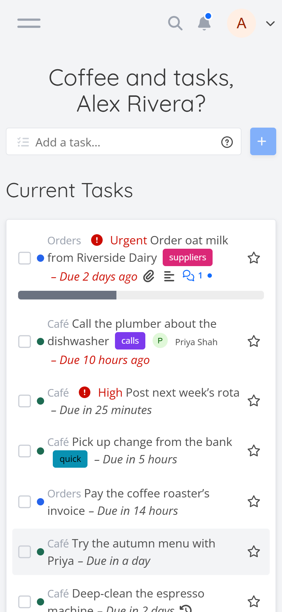
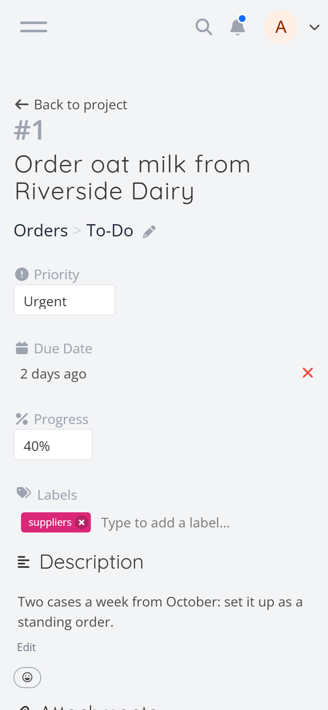
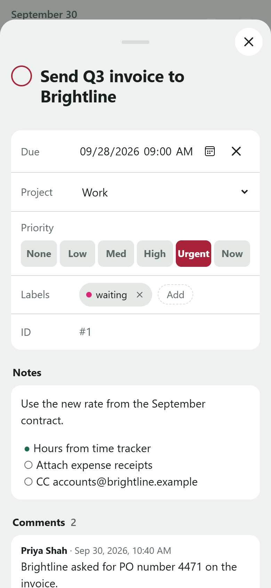
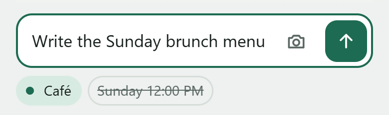
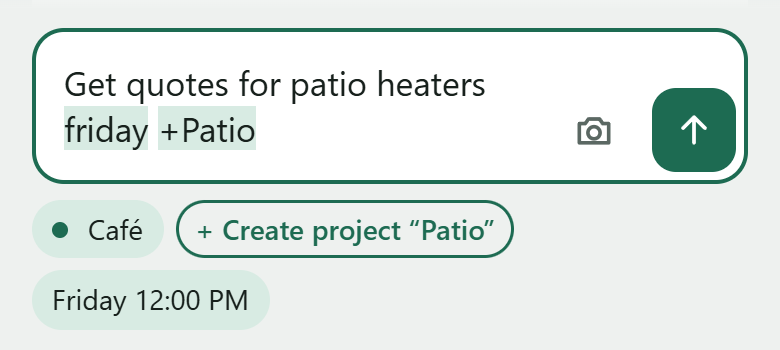
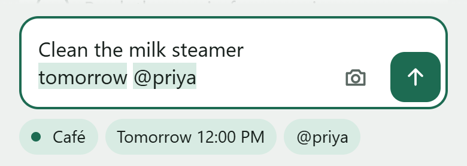
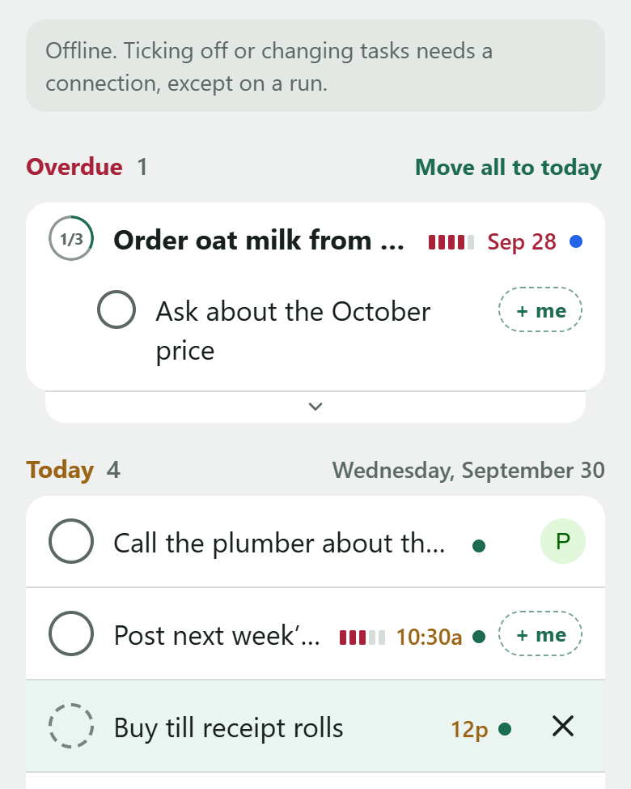

# Pocket guide

The [README](../README.md) says what Pocket is for and how to install it. The guide has each screen in full.

The examples follow a small café: Alex owns it, and Priya is the shift lead who opens up.

- [Pocket and Vikunja's web app](#pocket-and-vikunjas-web-app)
- [Tasks](#tasks)
- [Quick add](#quick-add)
- [Assigning](#assigning)
- [Checklists](#checklists)
- [Timed steps](#timed-steps)
- [Step times](#step-times)
- [Reminders and alerts](#reminders-and-alerts)
- [Offline](#offline)
- [Signing in with an API token](#signing-in-with-an-api-token)
- [Troubleshooting](#troubleshooting)
- [Privacy and security](#privacy-and-security)

## Pocket and Vikunja's web app

Vikunja's web app works on a phone, but it's built for a bigger screen. Pocket covers the day on your feet: what's due,
adding and finishing tasks, handing them on, and checklists. Boards, project settings and sharing stay in Vikunja.

<table>
  <tr>
    <th>Vikunja's web app</th>
    <th>Pocket</th>
  </tr>
  <tr>
    <td></td>
    <td></td>
  </tr>
  <tr>
    <td></td>
    <td></td>
  </tr>
</table>

<sub>Same account, same tasks, same phone-sized screen.</sub>

## Tasks

- **Today** groups tasks into Overdue, Today and Next 7 days, plus **Added today, no date**, so a task added without a
  date stays in view until tonight. A task is overdue once its time has passed, as in Vikunja, not at the end of its
  day; one due at midnight, as Vikunja's web app sets a day without a time, is overdue once that day is over. **Move all to today** brings every overdue task to today, each at the time
  of day it had, or the next whole hour if that has gone.
- **Cards:** a task with subtasks still open, or a checklist run with steps still open, is a card: its header, with a
  ring where a tick would be, over its subtasks. On Today and in search a card is folded to the subtask to do next:
  overdue first, then due today, then the earliest date, then in its project's order. A run's is its next step in
  order; a timed step whose time has come goes before it. A card is on Today when its task, or any of its open
  subtasks, is due. On a project's list a card is always open. Done subtasks are in the task's sheet.
- **A row works the same everywhere:** on Today, a project's list, search, a task's sheet and a run's steps. Its left
  edge ticks it, its title opens it, and its right end says who's doing it, or **+ me** (see **Assigning**, below).
  Swipe it right to say how far along it is, swipe it left to lower that or delete it, and hold it to move it: up or
  down on a project's list and in a task's sheet, to another day on Today. Every swipe and hold has a tap that does the
  same, in the task's **⋯** or its sheet: the way for a keyboard or a screen reader.
- **Ticking off:** a ticked task stays where it is, ticked and struck through, so nothing moves under your finger.
  Three seconds after your last tick, everything you ticked leaves together. On a project's list they go to its
  **Done** section, the most recently done first.
- **Progress:** swipe a task to the right: a ring fills to 25%, then 50%, then 75%, and nothing changes until you let
  go. Swipe on past half the row, until the green turns solid, and let go: the task is done. To lower it, swipe to the
  left, a quarter at a time; a done task swiped left opens again, at 75%. A swipe doesn't start from the screen's very
  edge, where the phone's Back starts. A task with subtasks has no progress of its own to swipe: its ring adds up its
  subtasks'.

  Swiping a task, a subtask or a step no one is doing, in a project shared with someone, says you're doing it: **+ me**
  turns into your picture, and it's assigned to you. Someone else's stays theirs. Swiping it back to 0% later keeps it
  yours: tap your picture to let it go.
- **Finishing a task with subtasks:** its ring is the average of its subtasks' progress, a done one counting 100%,
  with how many are done inside it ("1/4"). Pocket writes that figure to the task's progress in Vikunja too. Ticking a
  subtask never closes its task: once they're all done, the card says "All subtasks done" with **Close**, and waits
  for you. Tap the ring, or swipe the header all the way to the right, to complete a task with subtasks still open:
  with more than one left, Pocket asks first, naming them.
- **Moving a task on Today:** hold a task's row, or a card, until it lifts: four dates open around your finger, always
  in the same places, so with practice it's a flick that needs no looking. **Today** is to the left, **Tomorrow** to
  the right, **Next week** (next Monday) above and **No date** below. Move a short way towards one and let go: the
  task moves there, keeping its time of day, with **Undo**. Let go without moving, and the four dates stay open, to
  tap, with **Pick a date…** in the middle for any other day.
- **Order:** a project's list is in the order of its **List view** in Vikunja's web app, each subtask under its
  parent, so both show the same order. To move a task, hold it until it lifts, then move it up or down, among the
  tasks at its level. A subtask's **⋯** has **Turn into its own task**: it's put right after its task on the project's
  list. A checklist's steps keep an order of their own (see **In Vikunja's web app**, under Checklists).
- **Deleting:** swipe a task's row to the left and tap **Delete**, or swipe on past half the row, until the red turns
  solid, and let go. A task with progress first swipes down to 0%, so it takes a second swipe to delete: a slip can't.
  The row's place stays as a gap with **Restore**, and the task is deleted in Vikunja only once the gap closes, with
  the tasks you ticked.
- **The task sheet:** **Notes** are the task's own description in Vikunja, and **Comments** are Vikunja's comments.
  Subtasks are added with the same box as quick add, except `+project`: a subtask stays in its task's project, and
  moving a task to another project takes its subtasks along. In a project for checklists the box doesn't read dates
  either, as a task's subtasks there may become a template's steps, whose time is their own.
- **Sharing progress:** a task's **⋯**, a project's **⋯** and a run's **⋯** have **Share progress as a text**. It opens
  the phone's share sheet, to send it in a message, as a few plain lines:

  ```
  Pack the van  ▰▱▱▱ 38%
  ✓ Load chairs
  ◐ Tables 50%
  ○ Sound system · Priya
  ○ Lights
  ```

  A project's is its open tasks, each with its open subtasks, and a run's says who did each step. Notes aren't
  included. Where there's no share sheet (on most computers), the text is copied instead.
- **Copying:** beside it, for a task and a project, **Copy as a Markdown list** is the copy that comes back: pasted
  into Pocket's add box, it makes the same tasks.

  ```markdown
  ## Pack the van @priya !3 2026-10-16
  - [x] Load chairs
  - [ ] Tables
    - [ ] Legs
  - [ ] Lights (50%)
  - [ ] Sound system @sam *hire every week 2026-10-15 at 15:30
  ```

  Its dates are in numbers, so it means the same day whenever it's pasted. Notes, comments and photos aren't in it,
  nor a project's done tasks. A run has no Markdown copy: it's made again by starting its checklist.
- **Adding subtasks from the bottom box:** on a project's list, the box at the bottom adds tasks to that project.
  Touch a task (tick it, swipe its progress, open and close its sheet, or nudge it: put your finger on it and scroll a
  little, slowly) and the box adds subtasks to it instead, and says so: "Add a subtask to Pack the van". Touch a
  subtask, and they go right after it. The **×** beside the task's name goes back to adding a task.
- **Signing in:** sign in once, with your usual Vikunja login, and Pocket and Vikunja's web app are both signed in on
  that device.
- **A shortcut link:** `…/#/add?text=Order+milk` opens Pocket with the text filled in, handy from an iOS Shortcut or a
  bookmark.

## Quick add

Quick add uses the prefixes and phrases of Vikunja's [Quick Add Magic](https://vikunja.io/help/quick-add-magic/), and
follows your setting for it in Vikunja: the prefixes below, Todoist-style ones (`#project`, `@label`, `+person`), or
none. As you type, the words it reads are highlighted in the box, and chips under it show what will be saved.


| Type | Sets |
|---|---|
| `+orders` or `+"Café"` | Project: its full name or the start of it |
| `*suppliers` or `*"call back"` | Label, created if it doesn't exist |
| `@priya` | Person to assign, by username |
| `!1` to `!5` | Priority |
| `today`, `tomorrow`, `fri`, `next monday`, `in 3 days`, `end of month`, `Oct 12`, `2026-10-12`, `10/12` | Due date. Dates in numbers only count at the start or end, so "Table 4/5 wobbles" stays as it is. |
| `at 5`, `at 5pm`, `at 17:30` | Due time. A bare hour is daytime: `at 1` to `at 7` mean the afternoon or evening, where Vikunja reads `at 5` as 5 AM. Without a time, the task is due at your default due time from Vikunja's settings, noon unless you changed it. |
| `every day`, `every other week`, `every month`, `weekly` | Repeat. Vikunja can't repeat on weekdays only, or on two days a week: `every weekday` stays in the title, and a chip says so. |
| `(50%)` or `50%`, at the end | Progress, as a swipe would set it; `100%` is done. Pocket's own. |
| `x ` or `[x] `, at the start | Done already (below). Pocket's own. |

- **Read something you didn't mean?** Tap its chip and those words stay in the title. Tap again to undo. To turn it all
  off for one task, wrap the whole text in quotes: `"Friday night jazz poster"`. Quotes round the start of a line hold
  its title and leave the words after them to be read: `"Lunch friday" @priya tomorrow`. In Vikunja, quotes work only
  round the whole text.
- **Done already:** an `x` and a space at the start of a line, or a ticked checkbox, adds the task done: `x Call the
  plumber`, `[x] Call the plumber`, `- [x] napkins`. A capital `X` says done too, as a phone's keyboard starts a line
  with one: for a title like "X marks the spot", tap the **Done** chip. On a run's screen and in a template's steps, a
  ticked line is left out instead: a step is done by doing it.
- **Pasting a list:** each line becomes a task, with its own dates and shortcuts, and the whole list goes to one
  project, the first `+project` in it. A heading, an indent or a colon says which line the others go under: the lines
  under a `## ` heading are its subtasks, a line indented more than the line above it is under that line, and a first
  line ending with a colon, `Groceries:`, is the parent of the rest. A chip says what the list makes, **2 tasks + 7
  subtasks**, and **↳ Under first line** makes the rest subtasks of the first. Another counts the ticked lines, **2
  arrive done**: tap it to leave them out.

<table>
  <tr>
    <th>Tap a chip to undo it</th>
    <th>Paste a list</th>
    <th>Create a project</th>
  </tr>
  <tr>
    <td></td>
    <td></td>
    <td></td>
  </tr>
</table>

**Where else Pocket's quick add differs from Vikunja's.** The phrases come from Vikunja's own tests, so the same text
mostly gives the same task in both apps. Besides what's marked above, Pocket differs on purpose here:

- `every month` repeats on the same day each month. Vikunja's quick add uses every 30 days.
- Dates always mean the next one: in June, `2nd March` is next March.
- `10/12` follows your phone's region, which is 12 October in most places. Vikunja always reads it US-style.
- Pocket also understands `every monday`, `every other day` and `the 17th` anywhere in the text.

## Assigning

`@priya` in quick add, or **Assigned → Add** in a task's sheet, gives the task to someone. They can only be given a task
in a project they can see.



- **Without a `+project`:** if your default project isn't shared with them but exactly one of your projects is, Pocket
  picks that one and shows it as a chip; tap it to undo. Otherwise a chip says they can't see the project, before you
  send.
- **+ me**, at the end of a task's, a subtask's or a step's row, says you'll do it, which assigns it to you; tap your
  picture to let it go. Someone else's picture shows who has it. Swiping its progress claims it too (see **Progress**,
  under Tasks). Vikunja tells the task's creator, or for a step, whoever started the run.
- **+ me shows only where someone else could take it:** in a project shared with someone. In a project only you can
  see, the slot is empty.
- **Claiming never ticks anything,** and done is recorded for whoever taps it, whoever has the step.
- **A checklist run's row shows who the run is for**, and isn't tapped: change it from the run's **⋯**. Vikunja tells
  them about the run once, not once per step.
- **To hand one over,** open it and use **Assigned** (for a run's step: the run's **⋯** → **Open as a task**, then tap
  the step).

## Checklists

Checklists are the things done the same way again and again: opening up, closing down, a delivery check. Each start of
one is a run, with who did each step and when. They're ordinary Vikunja projects and tasks.

<p align="center"></p>

1. **Use a project for checklists.** Under Projects, **Set up checklists** makes a project called Checklists with an
   example template to try. Or open a project of yours, tap **⋯** and choose **Use for checklists**, or tick it in
   **New project**. Everyone it's shared with gets a **Checklists** tab. Share it with the people who'll run it, in
   Vikunja's web app: **Share it in Vikunja**, in the project's **⋯**, opens its share page. Pick **Read & write**:
   Vikunja starts on *Read only*, which lets them see runs but not tick steps.
2. **Make a template.** Under Checklists, tap **New template**, name it, and write its steps, a row each; a pasted list
   becomes a row a line. Each step is read as quick add reads a task: `@priya` assigns it, `*front` labels it, `!3`
   sets its priority. Dates aren't read there: a step's time is its own (see **Timed steps**). In the template's sheet,
   tap a step to change it, hold it to move it, and open **Notes and photos** under it to say how it's done: each run's
   copy of the step comes with them. A run also gets the template's own notes, attachments, labels and people. A task
   with its steps as subtasks becomes a template with **Use as checklist template**, in its sheet's **⋯**.
3. **Start a run.** Tap **Start** and tap everyone it's for. A step assigned to someone in the template stays assigned
   to them in every run. A name, like "Saturday", takes the place of "run 3" in the run's name. A run can be started
   without a connection, and is set up once Pocket reaches Vikunja.
4. **Work through it.** One step at a time, on its card: **Done**, or **Skip**. A comment typed on the step goes with
   either: Done posts it on the step, and Skip makes it the reason. Add a photo to a step, or a comment to the whole
   run. **Last time** shows the comments from the last finished run of the same template, as a handover. Tap a step
   under **Steps** to put it on the card. After the last step, **Finish run**. To finish early, tap the run's ring at
   the top of its screen: with steps not done, it asks first, and they stay not done.

- **A checklist that comes round:** give the template a date in its sheet, under **When it's due**, and how it
  **Repeats**: every day at 8:00, say. It's then Vikunja's repeating task: at its time it shows on Today, to its
  assignees (or, with none, everyone who can work on the project), and Vikunja emails its reminders. Tapping it opens
  Start. Starting a run of it on the day it's due moves it on to its next time, and the run is due at the time the
  template was, so one left open shows as overdue. A start at 7:55 is the 8:00 one; a start before its day doesn't
  move it on. Missed times aren't made up.
- **A step the template doesn't have:** the box at the bottom of a run's screen adds one after the step on the card,
  for this run only. **Repeat**, on the line above the box, does the step on the card again. Either says **Inserted**
  or **Repeated** under its title. The template never changes, and a step from the template can't be taken out of a
  run, only skipped.
- **Who did a step** is a ✅ reaction on it, or ⏭️ for a skipped one, so Vikunja's web app shows it too, with when:
  "Done by Priya at 4:46 PM". Vikunja lets each person take off only their own ✅, so marking someone else's step not
  done asks first: theirs stays on it.
- **Today** shows a run in progress as a card, to the person who started it and the people it's for (see **Cards**,
  under Tasks).
- **In Vikunja's web app**, a template is a task labelled `template`, its title starting "TEMPLATE: " so it isn't
  deleted by mistake, with its steps as done subtasks. It's done, unless it comes round: then it's a repeating task
  there, and ticking it there skips that time without a run. A run is a copy of it, named like "Opening up · run 3 ·
  Oct 4". The web app can't reorder steps, so reorder them in Pocket, which keeps the order in a line like
  `pocket:order 12 15 13` in the template's description. Leave that line be; steps it doesn't list, like one added in
  the web app, come last. A step added during a run has a line `pocket:added`. Everyone with *Write* access can change
  templates there too.

## Timed steps

Write the time in the step: "Dial in the grinder **in 20 min**", "Take the croissants out **after 18 minutes**", "Restock
the cups **20 minutes later**". A chip under the step shows what Pocket read, "⏱ 20m after the step before". To count
from another step, pick it in the chip, or write it: "Dial in the grinder **20 minutes after Turn on the espresso
machine**". Tap × to keep the words as they are. Words that tell what to do, like "steam **for** 2 minutes", aren't read
as a time.

Pocket saves the time in the step's title in the template, written the way PLC programs write times, which is also how
to write one in Vikunja's web app:

| In the step | It's due |
| --- | --- |
| `Wipe the counters T#20m` | 20 minutes after the step before it is done. On the first step, 20 minutes after the run starts. |
| `Put the croissants in the oven {#croissants}` | When it's next. `{#croissants}` names the step "croissants". |
| `Take the croissants out T#18m:croissants` | 18 minutes after the step named "croissants" is done, whatever is done in between. |

- Units are `d`, `h`, `m`, `s` and `ms`, and they combine: `T#1h30m`. A step without a `T#` has no due date: it's simply
  next.
- Picking a step to count from gives it a name made from its first words, like `{#put-the-croissants}`.
- A time counts from an earlier step, and each name is used once. Pocket checks this as you write the steps, when you
  move one, and when you start a run.
- A run's steps get their titles without `T#` and `{#…}`.
- A step inserted during a run has no time, and isn't "the step before" for the step after it. A repeated step has no
  time of its own, but a step timed from the one it repeats counts from whichever of them was done last.

## Step times

Timed steps get due dates in Vikunja, and so show on Today and in Vikunja's web app, through the plugin's step times:
`steptimes: true` in the [install's config](../README.md#install). Without it, Pocket still counts down on the run
screen.

When a step of a checklist run is marked done (in Pocket, in Vikunja's web app, or through the API), the
plugin sets the due date of each step of the same run timed from it: the time it was marked done, plus that step's
time. When the step is marked not done again, the steps waiting on it lose that due date until it's done again, so no
reminder goes off for a step that's still waiting. It writes only due dates (not even when a task was last changed),
and the time of a reminder counted from the due date, only on steps of that run that aren't done, and only when the
date changes. It only acts on a run Pocket would make: the run and its steps in one project, each step with the time
it was started with. It doesn't act on templates, or on a done step saved again. All of it is in one function, `writeStepDueDates` in [`pocket/main.go`](../pocket/main.go).
It can also be turned on with `VIKUNJA_PLUGINS_POCKET_STEPTIMES=true`.

A step ticked offline counts, in Vikunja, from when the tick reaches it. Pocket counts down from when you ticked it.

What it can't do:

- Vikunja's web app, and apps that sync through CalDAV, save a whole task from the copy they loaded. A step saved that
  way from a copy loaded before its due date was set loses the due date again (and its reminder). Pocket still counts
  down to it.
- The plugin sets due dates without changing when a task was last changed, so apps that sync through CalDAV, and
  Vikunja's saved filters, don't see them until the step is changed some other way.
- A tick Vikunja handles while it's restarting, or more than 2 minutes late, sets no due dates.

## Reminders and alerts

Pocket promises only what always works: **timers ring while Pocket is open, and reminders arrive by email when it's
closed.** It shows no system notifications and asks for no permission.

**While Pocket is open:**

- A run's countdown that reaches zero chimes, says so, and vibrates on Android, once per step. On an iPhone with the
  silent switch on, it may not sound.
- While a run with a countdown is on screen, the screen stays on, where the phone allows.
- The app's icon shows how many tasks are overdue, on phones that allow it.

**While it's closed, Vikunja emails reminders** to the task's creator and the people it's assigned to. That needs mail
set up on the server (`mailer` and `service.enableemailreminders` in Vikunja's config; on Cloudron, it's set up for
apps already), and reminder emails turned on in your own Vikunja settings. Pocket sets reminders in three places:

- **Reminders** in a task's sheet: at the due time, 15 minutes, an hour or a day before it, or at a set date and time.
- **🔔 in quick add:** type a time ("at 4pm", "in 2 hours") and a 🔔 chip offers a reminder at it. It's off until you tap
  it.
- **Timed steps** of a run get a reminder at their due time, which goes to whoever started the run and anyone who's
  claimed the step. It needs the plugin's [step times](#step-times). A step due less than a minute after the one it
  waits on gets none: Vikunja checks reminders once a minute.

Vikunja's web push, being worked on in [go-vikunja/vikunja#4020](https://github.com/go-vikunja/vikunja/pull/4020), would
let reminders ring the phone too.

## Offline

Pocket opens without a connection and shows your lists as they were last loaded.



- **What works offline:** new tasks and subtasks, comments, and what you do in a checklist run. Ticking off or editing
  other tasks needs a connection.
- **What's waiting:** a task waiting to be sent has a light tint and a dashed circle, and the refresh button at the
  top turns amber, with how many. Tap it for **Waiting to send**: each thing in words ("Done: Check the milk fridge"),
  with **Don't send it** on anything not started yet, and **Try now**.
- **Nothing you write is lost:** a comment, notes, subtasks or a new template is kept on the phone until it's sent,
  even if Pocket is closed, and through a sign-in that runs out. A task or comment Vikunja turns down for good says
  so, and its words go back in the box. Notes someone changed elsewhere while you wrote yours aren't written over: both
  are shown.
- **Sending:** waiting things are sent when Pocket is opened, when it comes back to the front, and when the connection
  returns, in the order they were done, and never twice. On an iPhone, they're sent the next time Pocket is opened,
  since iPhones don't let web apps send in the background.

## Signing in with an API token

If single sign-on and passwords don't suit you, Pocket also takes an API token. In Vikunja, go to *Settings → API
Tokens*, choose the **Task Management** preset, and also tick:

- **User** and **Users** under *Other*, and **Users search** under *Projects*: to find people for `@priya` and check that
  they can see the task's project. Without **Users search**, `@priya` still works, but people aren't suggested and no
  project is picked for them.
- **Create**, **Update** and **Delete** under *Projects*: to create projects from quick add, to rename, archive and use
  them for checklists, and to delete them.
- **Reactions**: for checklists, to record who did each step.

The preset already includes what moving tasks needs: **Position** under *Tasks*, and reading a project's views. A token
made without them shows each project in the order its tasks were made, and a move says which permission is missing.

A token is kept by Pocket alone, so signing in or out of Vikunja's web app doesn't affect it.

## Troubleshooting

- **Pocket's address shows "not found":** look for lines mentioning `pocket` or `plugin` in Vikunja's log.
  - `couldn't find app/index.html`: the files aren't at `plugins/pocket/app/`.
  - `Failed to load yaegi plugin pocket`: the plugin didn't load, for example because a Vikunja update changed how
    plugins work. Vikunja itself keeps running.
  - Nothing at all: plugins aren't turned on, or Vikunja hasn't been restarted since.
- **Vikunja's log shows the old version after an update:** the version in its log comes from `main.go`, which Vikunja
  reads when it starts. Restart Vikunja.
- **Stuck on Vikunja's page after single sign-on:** on the home screen, single sign-on opens in the same window and ends
  on Vikunja's page. Close that page to come back to Pocket. In a browser, it opens a new tab that closes by itself.
- **"Too many attempts from here":** Vikunja allows 10 sign-in attempts a minute from one address. Wait a minute.
- **"That token didn't work":** the token has expired, or **User** under *Other* isn't ticked.
- **"Your API token doesn't allow this":** the token is missing a permission ([see above](#signing-in-with-an-api-token)).
  Vikunja can't add permissions to an existing token, so create a new one.
- **"@priya can't see Inbox":** you can only assign people a project is shared with. Add a `+project` they can see, or
  share the project with them in Vikunja.

## Privacy and security

- Pocket has no server of its own. Vikunja serves its files, and Pocket only talks to that same Vikunja.
- Pocket uses Vikunja's own sign-in, stored in the browser where Vikunja's web app keeps it, and renews it the way
  Vikunja does. To revoke an API token entirely, delete it in Vikunja.
- To open at once and offline, Pocket keeps the lists it last loaded, what's waiting to be sent, and what you're still
  writing, in the browser on that device. Signing out removes them, and asks first if something is still waiting.
  Someone else signing in on that device never sees them: Pocket drops another account's lists before showing any. To
  know a sign-in is the one it last saw as yours, it keeps a fingerprint of it (its SHA-256 hash), never the sign-in
  itself.
- Notes and comments are cleaned before they're shown, and attachments other than images, PDFs and plain text are
  downloaded instead of opened. Together, these stop content from people you share projects with from running code
  inside Pocket, which shares its web address with Vikunja.
- The plugin runs inside Vikunja, so read [`pocket/main.go`](../pocket/main.go) before installing it. It serves the
  files in its `app/` folder and, with step times on, sets the due dates of checklist steps, and nothing else.
